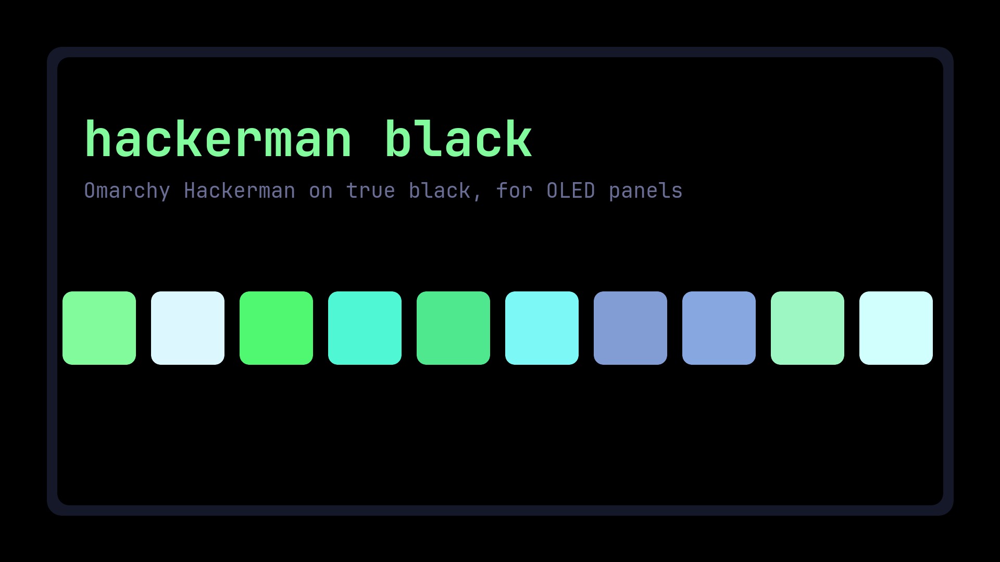

# Hackerman Black

Omarchy's Hackerman theme with true-black backgrounds, for OLED panels.



On an OLED screen a black pixel is switched off. Hackerman's background is a very dark navy (`#0B0C16`), which still lights every pixel. This theme keeps Hackerman's palette and sets the three background colours to `#000000`, so the bar, OSD, notifications, launcher, menus, lock screen and terminals leave those pixels off. Hover and selected surfaces keep Hackerman's lighter background so they stay visible.

## Install

```bash
omarchy theme install https://github.com/phedoreanu/omarchy-hackerman-black-theme
```

Then pick **Hackerman Black** from the theme menu. It ships one wallpaper, plain black. Use any other wallpaper you like with it; Hackerman's own work well too.

## Neovim

Omarchy does not load Lua from themes installed from git, so Neovim keeps the background that hackerman.nvim paints. To let Neovim show the terminal's black instead, add this to your own Neovim config:

```lua
vim.api.nvim_create_autocmd("ColorScheme", {
  callback = function()
    for _, group in ipairs({ "Normal", "NormalNC", "NormalFloat", "SignColumn", "EndOfBuffer", "FloatBorder" }) do
      vim.api.nvim_set_hl(0, group, vim.tbl_extend("force", vim.api.nvim_get_hl(0, { name = group }), { bg = "NONE" }))
    end
  end,
})
```

## Credit

The palette is Omarchy's Hackerman theme. Only the background values differ.
